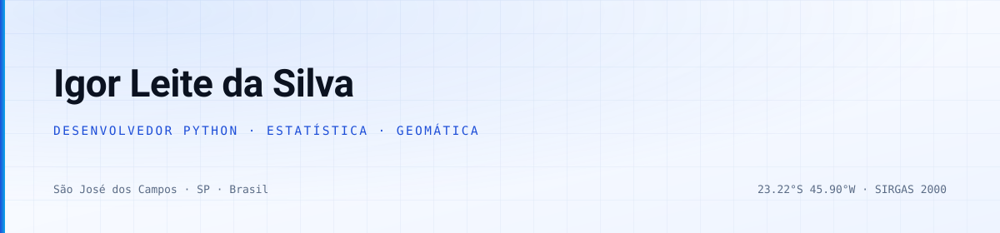
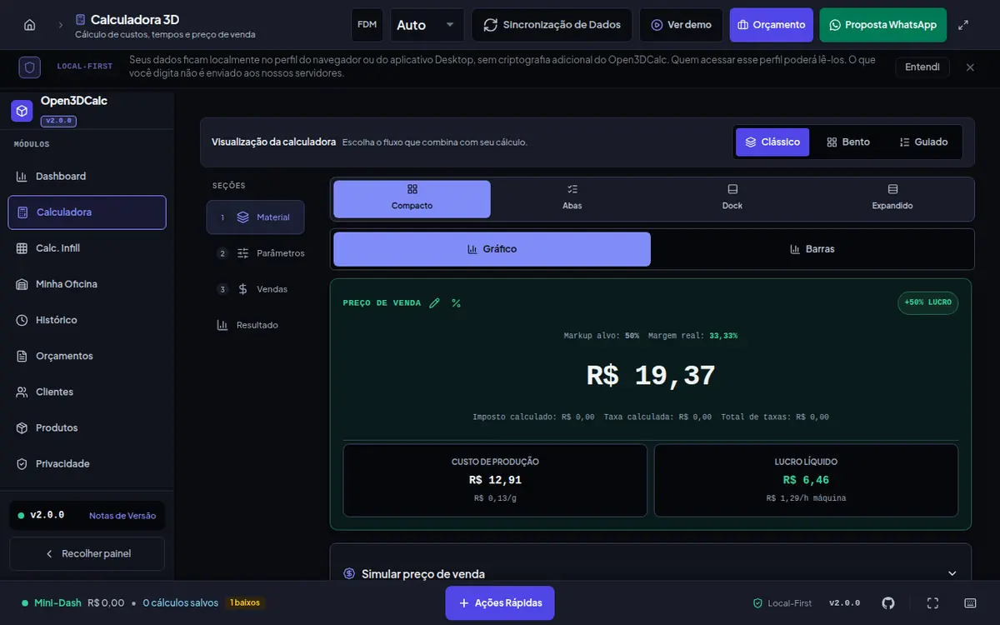
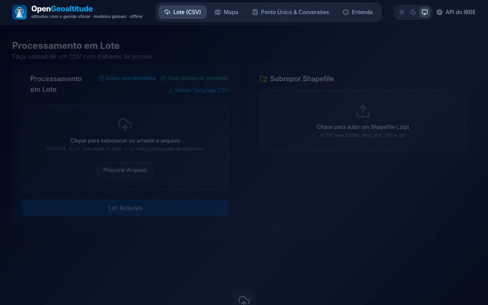

  <picture>
    <source media="(prefers-color-scheme: dark)" srcset="./assets/hero-dark.svg" />
    
  </picture>

  
  

Desenvolvo software onde medição vira decisão: sistemas de coordenadas, modelos geoidais, correção RTK e pipelines de dados em Python. Boa parte do meu trabalho é substituir planilha e processo manual por uma ferramenta que roda sozinha.

## Destaques

<table>
<tr>
<td width="50%" align="center" valign="top">

**[open3dcalc](https://github.com/ils15/open3dcalc)** · 17 estrelas

Calculadora de impressão 3D e utilitários de G-code · [demo](https://ils15.github.io/open3dcalc/)

</td>
<td width="50%" align="center" valign="top">

**[geoaltitude](https://github.com/ils15/geoaltitude)**

Altitude geométrica para ortométrica pelo geóide do IBGE · [demo](https://ils15.github.io/geoaltitude/)

</td>
</tr>
</table>

**[rbmc-ntrip-real-time-monitor](https://github.com/ils15/rbmc-ntrip-real-time-monitor)** — acompanha em tempo real a saúde de streams NTRIP/RTK: latência, idade da correção e queda de sinal. Serve para saber se o problema é o receptor ou a base.

## Outros projetos

- **[condominio-dados-abertos](https://github.com/ils15/condominio-dados-abertos)** — portal de dados abertos da manutenção predial (NBR 5674) · [demo](https://ils15.github.io/condominio-dados-abertos/)
- **[brasileirao-2026](https://github.com/ils15/brasileirao-2026)** — painel de dados da Série A · [demo](https://ils15.github.io/brasileirao-2026/)
- **[br-deforestation](https://github.com/ils15/br-deforestation)** — visualização de dados de desmatamento no Brasil
- **[download_manager](https://github.com/ils15/download_manager)** — gerenciador de downloads em Rust para Windows, com extensão de navegador e instalador
- **[pantheon-opencode](https://github.com/ils15/pantheon-opencode)** — orquestração multiagente para agentes de código · [docs](https://ils15.github.io/pantheon-opencode/)

## Ferramentas

     

## No momento

- Desenvolvendo ferramentas geoespaciais desktop em Rust
- Automatizando bots e canais no Telegram
- Estudando métodos estatísticos aplicados a dados espaciais
