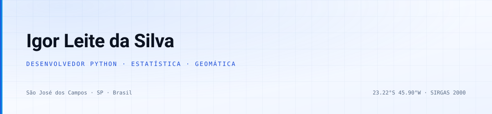

  <picture>
    <source media="(prefers-color-scheme: dark)" srcset="./assets/hero-dark.svg" />
    
  </picture>

  
  

Desenvolvo software onde medição vira decisão: sistemas de coordenadas, modelos geoidais, correção RTK e pipelines de dados em Python. Boa parte do meu trabalho é substituir planilha e processo manual por uma ferramenta que roda sozinha.

<table>
<tr>
<td valign="top" width="50%">

**Geomática**
`SIRGAS 2000` `PostGIS` `modelo geoidal` `NTRIP/RTK`

</td>
<td valign="top" width="50%">

**Dados**
`Python` `pandas` `NumPy` `estatística espacial`

</td>
</tr>
<tr>
<td valign="top" width="50%">

**Sistemas**
`Rust` `egui` `PostgreSQL` `Docker`

</td>
<td valign="top" width="50%">

**Automação**
`bots Telegram` `MCP` `agentes de código`

</td>
</tr>
</table>

## Projetos

**[curupira-gis](https://github.com/ils15/curupira-gis)** — SIG desktop para monitoramento florestal. Rust e egui na interface, dados em PostGIS com SIRGAS 2000 (SRID 4674). Nasceu da necessidade de trabalhar com datum brasileiro sem depender de licença proprietária.

**[geoaltitude](https://github.com/ils15/geoaltitude)** — converte altitude geométrica em ortométrica usando o modelo geoidal do IBGE. O erro que evita é de metros, e é justamente ele que quebra nivelamento em campo.

**[rbmc-ntrip-real-time-monitor](https://github.com/ils15/rbmc-ntrip-real-time-monitor)** — acompanha em tempo real a saúde de streams NTRIP/RTK: latência, idade da correção e queda de sinal. Serve para saber se o problema é o receptor ou a base.

**[open3dcalc](https://github.com/ils15/open3dcalc)** — calculadora de impressão 3D e utilitários de fluxo G-code.

**[pantheon-opencode](https://github.com/ils15/pantheon-opencode)** — orquestração de agentes de código com roteamento por domínio e gates de qualidade.

**[download_manager](https://github.com/ils15/download_manager)** — gerenciador de downloads em Rust para Windows: fila HTTP/HTTPS, retomada, extensão de navegador e instalador.

## Produtos no ar

**[Ofertas da China](https://ofertachina.com.br)** — guias de compra e cupons para importados, com bots e canais em Telegram.
**[condominio-dados-abertos](https://github.com/ils15/condominio-dados-abertos)** — portal de dados abertos da manutenção predial, organizado em torno da NBR 5674.

## Atividade

  <picture>
    <source media="(prefers-color-scheme: dark)" srcset="https://github-stats-extended.vercel.app/api?username=ils15&amp;show_icons=true&amp;hide_border=true&amp;bg_color=0A0F1A&amp;title_color=3B82F6&amp;text_color=C9D1D9&amp;icon_color=38BDF8&amp;rank_icon=github" />
    
  </picture>
  <picture>
    <source media="(prefers-color-scheme: dark)" srcset="https://github-stats-extended.vercel.app/api/top-langs?username=ils15&amp;layout=compact&amp;hide_border=true&amp;bg_color=0A0F1A&amp;title_color=3B82F6&amp;text_color=C9D1D9&amp;langs_count=8" />
    
  </picture>

---

Aberto a conversas sobre geomática, dados espaciais e automação em Python.
